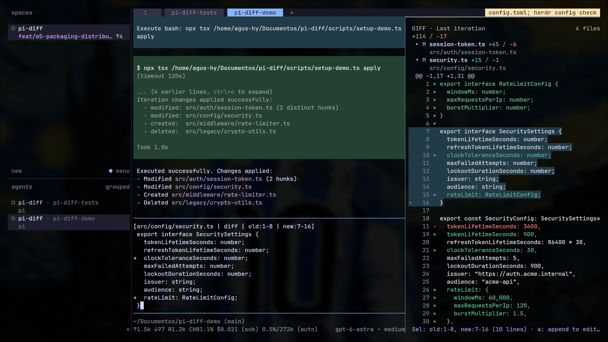

# pi-iteration-diff

A lightweight diff viewer for [Pi Coding Agent](https://github.com/earendil-works/pi-coding-agent).

Review the net changes from your last completed request in a side-by-side dock. Select lines and append them to your prompt without modifying Git state or sending your message automatically.



## Install

```bash
pi install git:github.com/agmonetti/pi-iteration-diff
```

For project-local installation, add `-l`.

## Features

- **Iteration-scoped diffs** — see what changed during the last request, separate from previous uncommitted work.
- **Git-safe** — never stages, commits, stashes, or modifies your Git index.
- **Side-by-side dock** — explore changes alongside Pi's conversation and editor, with adjustable width and auto-close when sending your next message.
- **Keyboard & mouse** — navigate files, expand hunks, select line ranges, and pan horizontally.
- **Selective feedback** — append selected changes as formatted diff excerpts to your existing prompt, without auto-sending.
- **Persistent width** — keep your preferred dock size across sessions and projects.

## Usage

| Action | Command / Key |
|---|---|
| Open / close dock | `/diff` |
| Open / focus dock | `F6` |
| Settings | `/diff-settings` |
| Navigate | `↑` / `↓` |
| Extend selection | `Shift+↑` / `Shift+↓` |
| Jump between files | `[` / `]` |
| Expand / collapse | `Enter` or click |
| Append selection to prompt | `a` |
| Horizontal pan | `←` / `→` or `h` / `l` |
| Resize dock | `Ctrl+←` / `Ctrl+→` |
| Return to editor / close maximized dock | `Esc` |
| Close dock | `q` |

## Configuration

Configure the dock using `/diff-settings`.

| Setting | Default | Options |
|---|---|---|
| Auto-open after iteration | Off | On / Off |
| Maximized full view | Off | On / Off |
| Line numbers | On | On / Off |
| File paths | Smart | Smart / Full / Filename |
| Collapse files | On | On / Off |
| Wrap long lines | Off | On / Off |
| Dock width | 45% | 30–60% |
| Remember dock width | On | On / Off |

**Auto-open after iteration** is saved in `<agent-dir>/iteration-diff.json` across Pi sessions, projects, and restarts. It opens a closed dock only for a complete individual iteration with net file changes; commit/push-only and conversation-only iterations do not open it. An already open dock remains open and refreshes, and `/diff` can always be opened manually to inspect an empty result. When enabled, **Remember dock width** also saves your preferred width there.

**Maximized full view** is saved in the same file. While the diff dock holds focus (F6 or a click on it), it occupies the entire Pi viewport instead of the configured dock width. In maximized mode `Esc` dismisses the dock entirely — only Pi's conversation and editor remain — and `F6` reopens it maximized; with the setting Off, `Esc` keeps the side dock open and returns focus to the editor as before. It never changes the saved dock width, and in narrow terminals (below 90 columns) the normal fallback still applies. With **Auto-open after iteration** also enabled, an auto-opened dock takes focus and fills the view immediately. Inside Herdr the maximized dock fills the whole Pi pane; Herdr's own sidebar, tabs, and status bar belong to Herdr, and its zoom feature covers the remaining window.

**Wrap long lines** is saved in `<agent-dir>/iteration-diff.json` across sessions and workspaces. It shows the full content of long diff rows instead of truncating them: a row longer than the available width continues on the following display row, breaking between words at whitespace — never mid-word. A single token longer than the whole line (a long URL or identifier) still splits by columns so nothing is lost. Continuation rows keep the line-number gutter blank and mark themselves with `│` under the `+`/`-` sign column. Cursor, selection, and mouse targeting stay per logical line, so a click on any continuation selects that whole row. While wrapping is On, horizontal pan (`←`/`→`/`h`/`l`) is inert because every column is already reachable; turning it Off restores the previous truncation and pan behavior. Hunk and file headers are always kept to a single row.

## Compatibility

- **Pi Coding Agent** 1.4.0+
- **Node.js** 22+
- **Linux, macOS, and native Windows**
- **Herdr** and standard terminal environments

## Limitations

- Drag-to-editor behavior depends on terminal capabilities. Use `a` to append selected changes reliably.
- Changes made by external processes may appear in the iteration diff and are not guaranteed to originate from the agent.
- Binary and non-UTF-8 files are omitted from text review. Oversized files with a verified PNG signature are also omitted after bounded, identity-checked reads; oversized text and unknown formats still produce partial captures. Binary/text transitions remain partial.
- Internal symlinks to text files captured separately in the same snapshot are omitted from content review; changes to their targets appear under the target path. Retargeting, creation, deletion, external/unreadable links, hardlinks, and special files remain partial rather than claiming a complete delta. Link metadata changes without retargeting are not reviewed.
- Files changed or deleted during capture may produce partial results. Capture limits text files to 1 MiB each; the viewer limits the combined before/after contents of each file to 1 MiB and 12,000 lines, with additional total and comparison-work limits. Exceeding a limit on eligible text is reported rather than presented as a complete diff.

## Next steps
- Add colapsable lines as a config option

## License

[MIT](LICENSE) © 2026 Agustin Monetti
