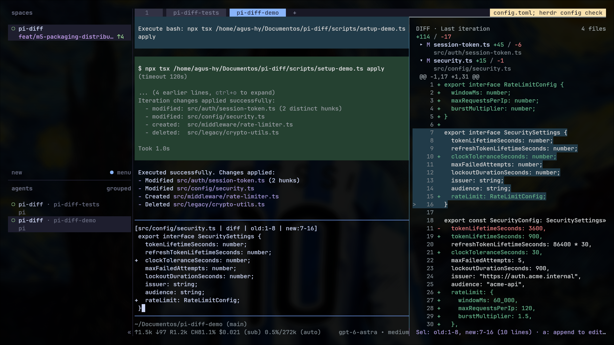

# pi-iteration-diff

A lightweight diff viewer for [Pi Coding Agent](https://github.com/earendil-works/pi-coding-agent).

Review the net changes from your last completed request in a side-by-side dock. Select lines and append them to your prompt without modifying Git state or sending your message automatically.



## Install

```bash
pi install git:github.com/agmonetti/pi-iteration-diff
```

For project-local installation, add `-l`.

## Features

- **Iteration-scoped diffs** — see what changed during the last request, separate from previous uncommitted work.
- **Git-safe** — never stages, commits, stashes, or modifies your Git index.
- **Side-by-side dock** — explore changes alongside Pi's conversation and editor, with adjustable width.
- **Keyboard & mouse** — navigate files, expand hunks, select line ranges, and pan horizontally.
- **Selective feedback** — append selected changes as formatted diff excerpts to your existing prompt, without auto-sending.
- **Persistent width** — keep your preferred dock size across sessions and projects.

## Usage

| Action | Command / Key |
|---|---|
| Open / close dock | `/diff` |
| Open / focus dock | `F6` |
| Settings | `/diff-settings` |
| Navigate | `↑` / `↓` |
| Extend selection | `Shift+↑` / `Shift+↓` |
| Jump between files | `[` / `]` |
| Expand / collapse | `Enter` or click |
| Append selection to prompt | `a` |
| Horizontal pan | `←` / `→` or `h` / `l` |
| Resize dock | `Ctrl+←` / `Ctrl+→` |
| Return to editor | `Esc` |
| Close dock | `q` |

## Configuration

Configure the dock using `/diff-settings`.

| Setting | Default | Options |
|---|---|---|
| Auto-open after iteration | Off | On / Off |
| Line numbers | On | On / Off |
| File paths | Smart | Smart / Full / Filename |
| Collapse files | On | On / Off |
| Dock width | 45% | 30–60% |
| Remember dock width | On | On / Off |

**Auto-open after iteration** is saved in `<agent-dir>/iteration-diff.json` across Pi sessions, projects, and restarts. When enabled, **Remember dock width** also saves your preferred width there.

## Compatibility

- **Pi Coding Agent** 1.4.0+
- **Node.js** 22+
- **Linux, macOS, and native Windows**
- **Herdr** and standard terminal environments

## Limitations

- Drag-to-editor behavior depends on terminal capabilities. Use `a` to append selected changes reliably.
- Changes made by external processes may appear in the iteration diff and are not guaranteed to originate from the agent.
- Binary and non-UTF-8 files are explicitly omitted from text review and do not block opt-in automatic opening. Their changes are not reviewed. Text/binary transitions remain partial because one endpoint is unknown.
- Files changed or deleted during capture may produce partial results. Capture currently limits each file to 1 MiB; the viewer limits the combined before/after contents of each file to 1 MiB and 12,000 lines, with additional total and comparison-work limits. Exceeding a limit is reported rather than presented as a complete diff.

## License

[MIT](LICENSE) © 2026 Agustin Monetti
