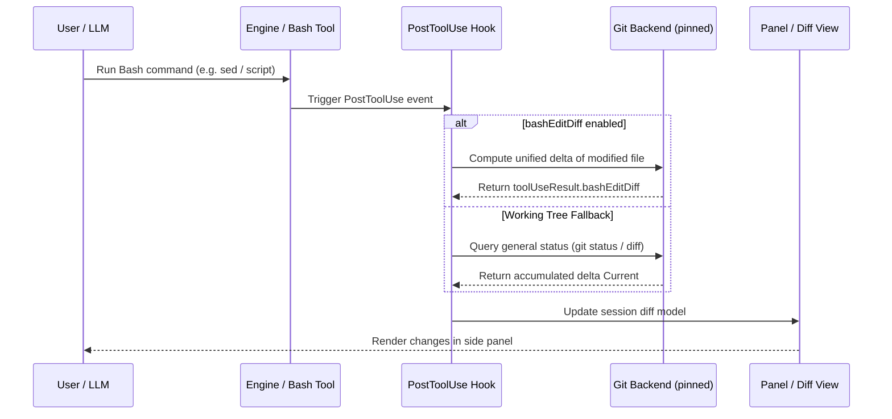
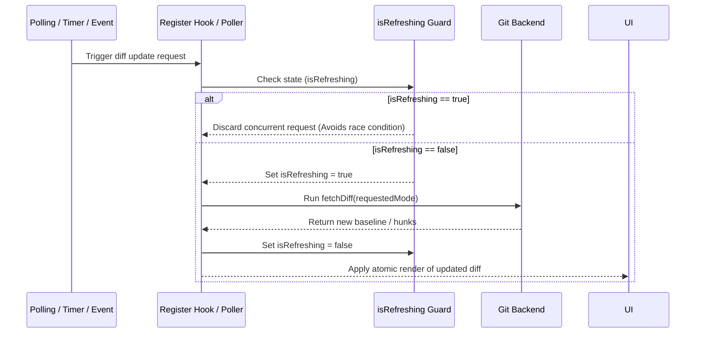

# Technical Research #2 — Claude Code Diff: Bash Attribution & Concurrency Deep Dive

**Research Date:** 2026-10-23
**Reference Repository:** `anthropics/claude-code`, directory `mods/diff`
**Scope:** Strict documentary research (no runtime code modifications, M1 and ADR-003 unaltered).

---

## 1. Executive Summary

This document delves into two critical mechanisms of Claude Code's `/diff` system (`mods/diff`):
1. **Attribution of changes produced by Bash:** Demonstrates that Claude Code combines accumulated working tree inspection (`git diff HEAD`, untracked files) with tool-specific execution telemetry (`bashEditDiff`, introduced in v2.1.269). However, **it does not offer perfect or deterministic per-turn attribution** for background processes or spawned subprocesses outside the direct cycle of the Bash tool.
2. **Concurrency and stale update prevention:** Identifies the coordinated use of a concurrency guard (`isRefreshing`), a pinned-path Git backend (`gitBackendOf`), and mode-bounded promises (`fetchDiff`) that discard or serialize overlapping updates to prevent race conditions.

---

## 2. Bash-Produced Changes Attribution Analysis

### 2.1. How does the backend detect Bash and PowerShell modifications?
Claude Code operates via a hybrid model to capture shell-driven modifications (`bash` / `powershell`):
- **Global Working Tree (`Current`):** By default, any command executed in persistent terminal that modifies, creates, or deletes files alters uncommitted repository state (`git diff HEAD` + `git status --porcelain`).
- **Tool Telemetry (`bashEditDiff`):** Starting from version v2.1.269, the system logs `toolUseResult.bashEditDiff` in `PostToolUse` hooks. This heuristically captures unified diffs generated around shell editing commands (e.g., `sed`, heredocs, `>` redirections, or executed scripts).

### 2.2. Do they appear exclusively in `Current` or also in turns (`T1`, `T2`)?
- **Turns (`T1`, `T2`, ...):** Rely on engine recorder (`Record.recorderOf(engine)`) associated with LLM turn transitions and tool events.
- **Fundamental limitation:** Changes made by orphaned subprocesses, background/async jobs, or accumulated modifications outside active turn **cannot be deterministically attributed to an individual turn `Tn`**. Therefore, such changes gravitate and reflect primarily in accumulated working tree view (`Current`), while individual turns depend strictly on tool invocation boundaries.

### 2.3. Edge Cases (Multiple files, subprocesses, pre-altered files)
- **Multiple files:** If a Bash script simultaneously modifies multiple files, `bashEditDiff` processes the resulting per-file diff, but partial failures or shell buffer limit truncations may omit entire files or hunks.
- **Complex subprocesses and pipes:** If a command invokes a secondary process writing to files asynchronously after `PostToolUse` hook return, the system does not capture event in current turn, requiring working tree polling (`Current`) to detect it.
- **Pre-altered files:** If a file already modified by user or another turn is altered again by Bash, calculated delta represents net difference relative to session's original baseline (`wasDirtyAtStart`), not an algebraic superposition of per-turn patches.

> **Answer to central question:** Claude Code **cannot reconstruct the exact delta produced by Bash in an individual turn** in the presence of asynchronous execution or subprocesses; it can only attribute direct changes bounded to tool's `PostToolUse` hook and reflect accumulated state in working tree (`Current`).

---

## 3. Concurrency and Stale Update Analysis

### 3.1. Concurrency Control Mechanisms
Analysis of `mods/diff/hooks/register.ts` and associated components reveals following defensive patterns against concurrency:
- **Mutual exclusion flag (`isRefreshing`):** When diff update or polling is in progress, `isRefreshing = true` blocks concurrent recalculation requests until active promise finishes.
- **Pinned backend (`gitBackendOf`):** All Git queries execute using root environment pinned by `git rev-parse --show-toplevel` with explicit `--git-dir` and `--work-tree`, preventing directory drifts or context corruption if session changes working path.
- **Requested mode invalidation (`requestedMode`):** `fetchDiff` results cached and associated to active mode. If session, branch, or `HEAD` change, or if user changes mode, pending promises invalidated or discarded if result belongs to prior state.

### 3.2. Race Condition Prevention
- Strict serialization of Git read operations and TUI rendering.
- Synchronous verification of state before and after resolving async calls, preventing slow overlapping Git response from overwriting subsequent working tree mutation.

---

## 4. Sequence Diagrams

### 4.1. Bash Execution Flow and Diff Capture (`bashEditDiff`)

### 4.2. Stale Update Prevention via Concurrency

---

## 5. Comparison with ADR-003 and M1 Architecture

| Dimension | Claude Code (`mods/diff`) | ADR-003 / M1 (`pi-iteration-diff`) | Evaluation |
|---|---|---|---|
| **Grouping Unit** | Individual turns (`T1`, `T2`) + `Current` view | Last completed user iteration (`agent_settled`) | **ADAPT:** Pi lacks direct LLM turns exposed identically; logical iteration is more robust and avoids false attribution from retries. |
| **Bash Attribution** | `bashEditDiff` heuristic in `PostToolUse` + Working Tree | Agnostic working tree capture pre/post iteration (`M1`) | **ADOPT / ALIGN:** M1 avoids guessing Bash per-turn attribution and captures iteration net delta, keeping simplicity without fragile telemetry. |
| **Concurrency** | `isRefreshing` lock + pinned git backend | Synchronous serialization in isolated controller and post-await verification | **ADOPT:** Using mutual exclusion flag (`isRefreshing`) and pinned backend is directly applicable to our snapshot controller. |

---

## 6. Concrete Recommendations (`ADOPT`, `ADAPT`, `REJECT`)

1. **`ADOPT` — Concurrency Guard (`isRefreshing`):** Implement semaphore or boolean exclusion flag in our capture controller to discard overlapping Git polls during heavy async operations.
2. **`ADOPT` — Pinned Git Root:** Ensure all Git calls operate with explicit `--git-dir` and `--work-tree` discovered once upon session start (`git rev-parse --show-toplevel`), avoiding issues if execution changes directory.
3. **`ADAPT` — Bash Changes Handling:** Do not attempt granular per-turn attribution for complex or asynchronous Bash commands; maintain attribution at user iteration level (ADR-003), using pre/post agent execution state.
4. **`REJECT` — Proprietary Engine Recorders (`Record.recorderOf`):** Rejected as depending on closed internal Claude Code SDK architecture. Pi uses stable public events (`pi-lifecycle.ts`).

---

## 7. Unresolved Risks and Necessary Evidence

- **Risk 1:** Extreme concurrency where multiple concurrent writes occur exactly at iteration change boundary.
  - *Necessary evidence:* Integration tests with rapid overlapping writes in worktree during `agent_settled` event.
- **Risk 2:** Git status/diff performance in massive repositories with thousands of untracked files.
  - *Necessary evidence:* Snapshot capture time benchmarks with large synthetic repositories (>= 10,000 files).
