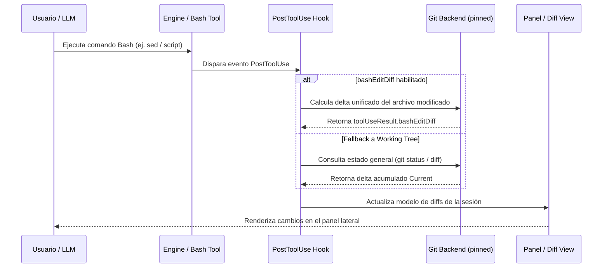
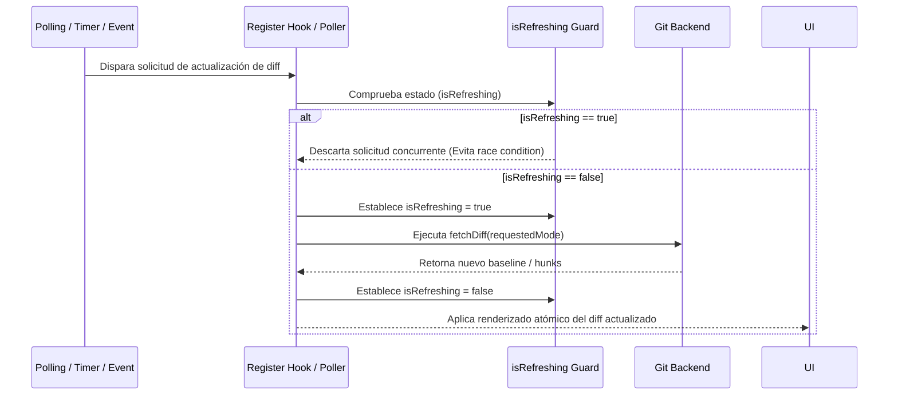

# Investigación técnica #2 — Claude Code Diff: Bash Attribution & Concurrency Deep Dive

**Fecha de investigación:** 2026-10-23  
**Repositorio de referencia:** `anthropics/claude-code`, directorio `mods/diff`  
**Alcance:** Investigación documental estricta (sin modificaciones de código runtime, sin alterar M1 ni ADR-003).

---

## 1. Resumen ejecutivo

Este documento profundiza en dos mecanismos críticos del sistema `/diff` de Claude Code (`mods/diff`):
1. **Atribución de cambios producidos por Bash:** Demuestra que Claude Code combina la inspección acumulada del working tree (`git diff HEAD`, untracked files) con telemetría específica de ejecución de herramientas (`bashEditDiff`, introducida en v2.1.269). Sin embargo, **no ofrece una atribución perfecta ni determinista por turno** para procesos en segundo plano o subprocesos desatados fuera del ciclo directo de la herramienta Bash.
2. **Concurrencia y prevención de actualizaciones obsoletas:** Identifica el uso coordinado de un guardián de concurrencia (`isRefreshing`), un backend de Git con ruta anclada (`gitBackendOf`), y promesas acotadas por modo (`fetchDiff`) que descartan o serializan actualizaciones superpuestas para evitar condiciones de carrera.

---

## 2. Análisis de atribución de cambios producidos por Bash

### 2.1. ¿Cómo detecta el backend las modificaciones de Bash y PowerShell?
Claude Code opera mediante un modelo híbrido para capturar modificaciones impulsadas por shell (`bash` / `powershell`):
- **Working Tree Global (`Current`):** Por defecto, cualquier comando ejecutado en la terminal persistente que modifique, cree o elimine archivos altera el estado no commiteado del repositorio (`git diff HEAD` + `git status --porcelain`).
- **Telemetría de Herramienta (`bashEditDiff`):** A partir de la versión v2.1.269, el sistema registra `toolUseResult.bashEditDiff` en los hooks de `PostToolUse`. Esto captura de forma heurística los diffs unificados generados alrededor de comandos de edición por shell (p. ej., `sed`, heredocs, redirecciones `>` o scripts ejecutados).

### 2.2. ¿Aparecen únicamente en `Current` o también en turnos (`T1`, `T2`)?
- **Turnos (`T1`, `T2`, ...):** Se apoyan en el grabador del motor (`Record.recorderOf(engine)`) asociado a las transiciones de turnos del LLM y eventos de herramientas.
- **Limitación fundamental:** Los cambios realizados por subprocesos huérfanos, procesos en segundo plano (*daemonized/async jobs*), o modificaciones acumuladas fuera del turno activo **no pueden atribuirse de forma determinista a un turno individual `Tn`**. Por lo tanto, tales cambios gravitan y se reflejan primariamente en la vista acumulada del working tree (`Current`), mientras que los turnos individuales dependen estrictamente de los límites de invocación de la herramienta.

### 2.3. Casos límite (Múltiples archivos, subprocesses, archivos pre-alterados)
- **Múltiples archivos:** Si un script de Bash modifica simultáneamente múltiples archivos, `bashEditDiff` procesa el diff por archivo resultante, pero las fallas parciales o truncamientos de salida por límites de buffer del shell pueden omitir archivos o hunks enteros.
- **Subprocesos y pipes complejos:** Si un comando invoca un proceso secundario que escribe en archivos de forma asíncrona tras el retorno del hook `PostToolUse`, el sistema no captura el evento en el turno actual, requiriendo un sondeo del working tree (`Current`) para detectarlo.
- **Archivos pre-alterados:** Si un archivo ya modificado por el usuario u otro turno es alterado nuevamente por Bash, el delta calculado representa la diferencia neta respecto al baseline original de la sesión (`wasDirtyAtStart`), no una superposición algebraica de parches por turno.

> **Respuesta a la pregunta central:** Claude Code **no puede reconstruir el delta exacto producido por Bash en un turno individual** en presencia de ejecuciones asíncronas o subprocesos; sólo puede atribuir cambios directos acotados al hook `PostToolUse` de la herramienta y reflejar el estado acumulado en el working tree (`Current`).

---

## 3. Análisis de concurrencia y actualización obsoleta

### 3.1. Mecanismos de control de concurrencia
El análisis de `mods/diff/hooks/register.ts` y componentes asociados revela los siguientes patrones defensivos frente a la concurrencia:
- **Flag de exclusión mutua (`isRefreshing`):** Cuando una actualización o sondeo de diffs está en curso, `isRefreshing = true` bloquea nuevas solicitudes concurrentes de recálculo hasta finalizar la promesa activa.
- **Backend anclado (`gitBackendOf`):** Todas las consultas de Git se ejecutan utilizando un entorno raíz fijado por `git rev-parse --show-toplevel` con `--git-dir` y `--work-tree` explícitos, previniendo derivas de directorio o corrupción de contexto si la sesión cambia de ruta de trabajo.
- **Invalidación por modo solicitado (`requestedMode`):** Los resultados de `fetchDiff` se cachean y asocian al modo activo. Si la sesión, rama o `HEAD` cambian, o si el usuario cambia de modo, las promesas pendientes se invalidan o se descartarán si el resultado pertenece a un estado anterior.

### 3.2. Prevención de condiciones de carrera
- Serialización estricta de las operaciones de lectura de Git y renderizado de la TUI.
- Verificación síncrona del estado antes y después de resolver llamadas asíncronas, evitando que una respuesta lenta de Git superpuesta sobrescriba una mutación posterior del working tree.

---

## 4. Diagramas de secuencia

### 4.1. Flujo de ejecución de Bash y captura de diffs (`bashEditDiff`)

### 4.2. Prevención de actualizaciones obsoletas por concurrencia

---

## 5. Comparación con ADR-003 y la arquitectura de M1

| Dimensión | Claude Code (`mods/diff`) | ADR-003 / M1 (`pi-iteration-diff`) | Evaluación |
|---|---|---|---|
| **Unidad de Agrupación** | Turnos individuales (`T1`, `T2`) + Vista `Current` | Última iteración completada del usuario (`agent_settled`) | **ADAPT:** Pi carece de turnos LLM directos expuestos de forma idéntica; la iteración lógica es más robusta y evita falsas atribuciones por reintentos. |
| **Atribución de Bash** | Heurística `bashEditDiff` en `PostToolUse` + Working Tree | Captura agnóstica de working tree antes/después de la iteración (`M1`) | **ADOPT / ALIGN:** M1 evita adivinar atribuciones de Bash por turno y captura el delta neto de la iteración, manteniendo la simplicidad sin telemetría frágil. |
| **Concurrencia** | `isRefreshing` lock + pinned git backend | Serialización síncrona en controlador aislado y verificación post-await | **ADOPT:** El uso de un flag de exclusión mutua (`isRefreshing`) y un backend anclado es directamente aplicable a nuestro controlador de snapshots. |

---

## 6. Recomendaciones concretas (`ADOPT`, `ADAPT`, `REJECT`)

1. **`ADOPT` — Guardián de concurrencia (`isRefreshing`):** Implementar un semáforo o flag booleano de exclusión en nuestro controlador de captura para descartar sondeos superpuestos de Git durante operaciones asíncronas pesadas.
2. **`ADOPT` — Pinned Git Root:** Asegurar que todas las llamadas a Git operen con `--git-dir` y `--work-tree` explícitos descubiertos una sola vez al iniciar la sesión (`git rev-parse --show-toplevel`), evitando problemas si la ejecución cambia de directorio.
3. **`ADAPT` — Gestión de cambios de Bash:** No intentar una atribución granular por turno para comandos Bash complejos o asíncronos; mantener la atribución a nivel de iteración de usuario (ADR-003), utilizando el estado antes/después de la ejecución del agente.
4. **`REJECT` — Grabadores propietarios del motor (`Record.recorderOf`):** Rechazado por depender de los internals cerrados del SDK de Claude Code. Pi utiliza eventos públicos estables (`pi-lifecycle.ts`).

---

## 7. Riesgos no resueltos y evidencia necesaria

- **Riesgo 1:** Concurrencia extrema donde múltiples escrituras concurrentes ocurren exactamente en el límite de un cambio de iteración.
  - *Evidencia necesaria:* Tests de integración con escrituras rápidas superpuestas en el worktree durante el evento `agent_settled`.
- **Riesgo 2:** Rendimiento de Git status/diff en repositorios masivos con miles de archivos untracked.
  - *Evidencia necesaria:* Benchmarks de tiempo de captura de snapshots con repositorios sintéticos grandes (>= 10,000 archivos).
